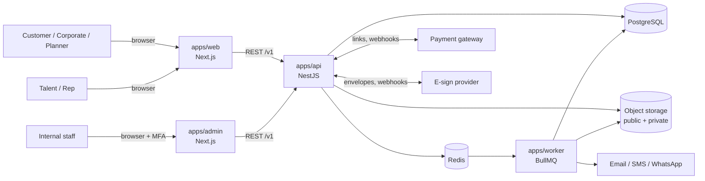
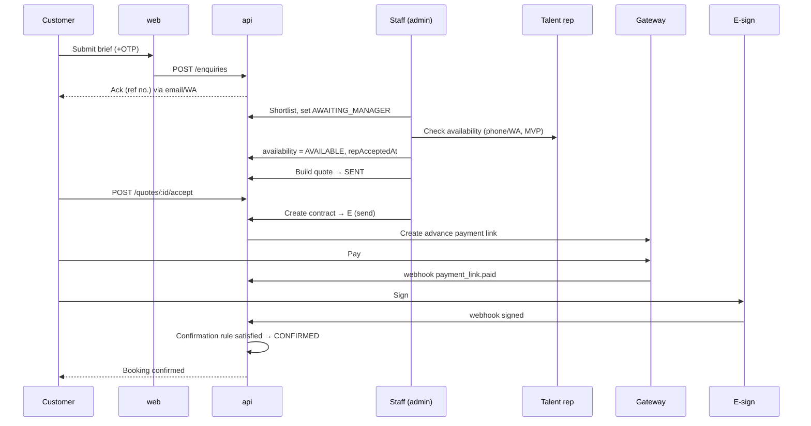
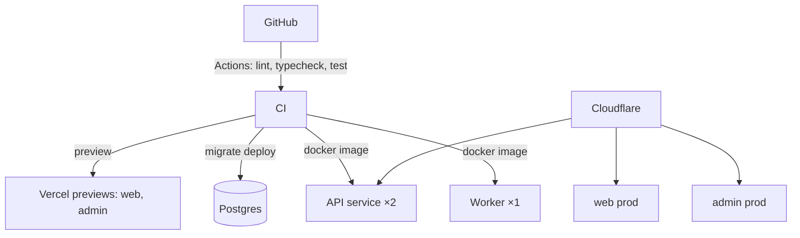

# Architecture — Talent & Celebrity Booking Platform

> v1.0 · 16 Oct 2026 · Related: `trd.md`

---

## 1. System context



## 2. Containers

| Container | Tech | Responsibility | Scales by |
|---|---|---|---|
| `web` | Next.js (SSR/ISR) | Public SEO pages, search, profiles, enquiry, customer dashboard, talent portal | Vercel/edge |
| `admin` | Next.js (client-heavy) | CRM: pipeline, talents, quotes, payments, analytics | Vercel |
| `api` | NestJS | Business logic, auth, RBAC, state machine, integrations, webhooks | Stateless replicas |
| `worker` | NestJS standalone + BullMQ | Notifications, PDFs, reminders, reconciliation, webhook processing | Replicas per queue |
| Postgres | Managed PG 16 | Source of truth | Vertical, read replica later |
| Redis | Managed | Queues, rate limits, short cache | Managed |
| Object storage | S3/R2 | Media (public via CDN), documents (private) | — |

## 3. API internal structure (modular monolith)

```
apps/api/src/
├─ main.ts
├─ app.module.ts
├─ common/            # guards (auth, roles, ownership), interceptors (audit, serialize), filters, pipes (zod)
├─ config/            # zod-validated env
├─ infra/             # prisma.service, redis, queues, storage, providers (payment, esign, messaging adapters)
└─ modules/
   ├─ auth/  users/  catalog/  talents/  reps/
   ├─ enquiries/  bookings/  quotes/  contracts/
   ├─ payments/  payouts/  documents/
   ├─ notifications/  analytics/  audit/  favourites/
```
Each module: `controller → service → repository (Prisma)`, DTOs from `packages/schemas`, domain events via `@nestjs/event-emitter`. Modules talk through services/events, never through each other's repositories.

Why modular monolith: one team, one DB, strong transactions around money; modules can be split into services later if needed.

## 4. Key flows

### 4.1 Enquiry → confirmed booking


### 4.2 Webhook processing
1. Controller verifies signature → 400 if invalid.
2. Insert `WebhookEvent(id)`; unique conflict → return 200 (duplicate).
3. Enqueue `webhooks` job; return 200 fast.
4. Worker processes in a DB transaction, updates milestone/payment, emits domain event.
5. Domain handler re-evaluates confirmation rule.

### 4.3 Settlement
Event completed → payout record (contracted payout) → Accounts pays externally → marks PAID with reference → when balance milestone PAID and payout PAID → lead CLOSED.

## 5. Data ownership

| Domain | Owner module | Sensitive |
|---|---|---|
| Users, roles, sessions | auth/users | PII, MFA secrets |
| Talent profile, media | talents/catalog | public |
| Rate cards | talents | INTERNAL |
| Reps, KYC | reps | PII, KYC docs |
| Leads, bookings | enquiries/bookings | PII |
| Quotes | quotes | margin INTERNAL |
| Milestones, payments, payouts | payments/payouts | financial |
| Documents | documents | contracts, KYC |
| Audit | audit | read-only |

## 6. Security architecture
- **Edge:** Cloudflare (WAF, bot protection, Turnstile).
- **AuthN:** access JWT (15 min) + refresh in httpOnly Secure SameSite=Strict cookie, rotated; staff MFA.
- **AuthZ:** role guard + ownership guard + audience-specific serializers (defence in depth for margin data).
- **Data:** TLS everywhere; DB encrypted at rest; app-level encryption for secrets/KYC fields; private bucket + presigned URLs.
- **Audit:** interceptor writes `AuditLog` for mutating requests on audited entities.

## 7. Deployment


- Region: India (ap-south-1 / Mumbai) for API, DB, storage.
- Migrations: `prisma migrate deploy` in CI before API rollout; backwards-compatible migrations only.
- Zero-downtime rolling deploys for API.

## 8. Phase evolution
| Phase | Architectural change |
|---|---|
| 2 | Talent portal self-service routes; calendar sync adapter (Google/Outlook); contract template engine; automated payouts adapter (RazorpayX) |
| 3 | `organizations` module (corporate accounts, approvals); `campaigns` module (deliverables, social metrics ingestion jobs) |
| 4 | `matching` module (LLM brief parsing → structured filters → ranked shortlist; embeddings in pgvector); public API with API keys; React Native app consuming same `/v1` API; possible OpenSearch if catalogue > ~50k |

## 9. Architecture decision records (ADR summary)
| # | Decision | Status |
|---|---|---|
| ADR-1 | Modular monolith NestJS, not microservices | Accepted |
| ADR-2 | Separate admin app from customer app | Accepted |
| ADR-3 | Money in integer paise, percentages in bps | Accepted |
| ADR-4 | Confirmation is system-derived, never manual | Accepted |
| ADR-5 | Postgres full-text before search engine | Accepted |
| ADR-6 | Provider adapters for payment, e-sign, messaging | Accepted |
| ADR-7 | Web/PWA first; native apps in Phase 4 | Accepted |
| ADR-8 | Payment gateway = Razorpay | Proposed — confirm in Phase 0 |
